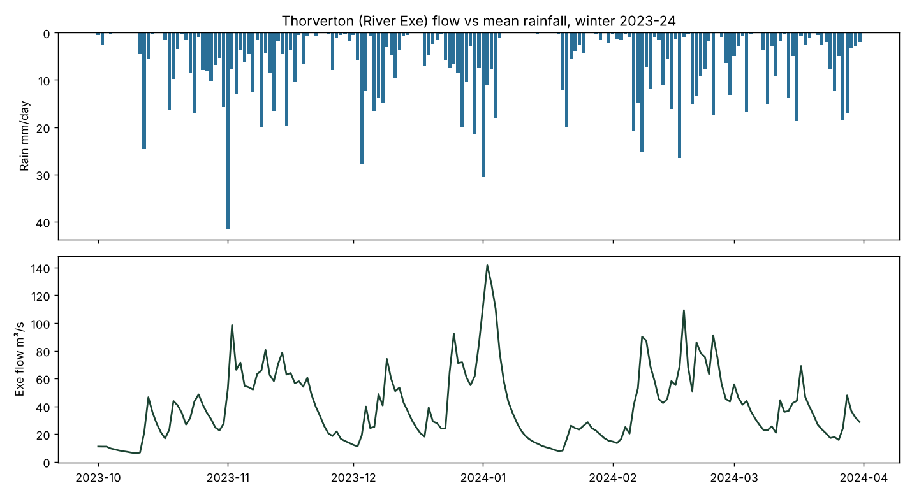
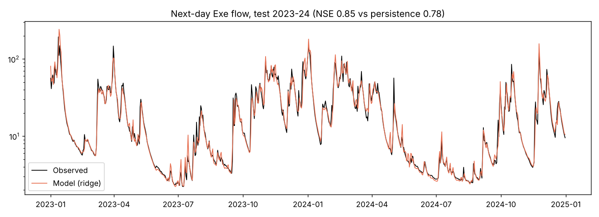
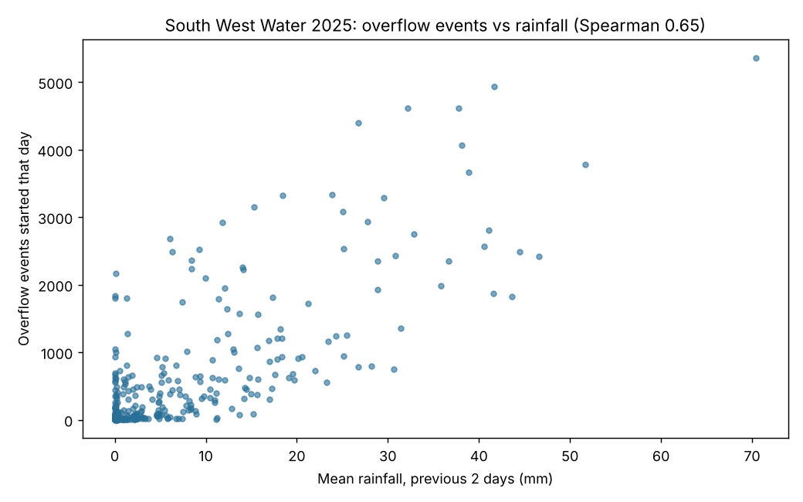
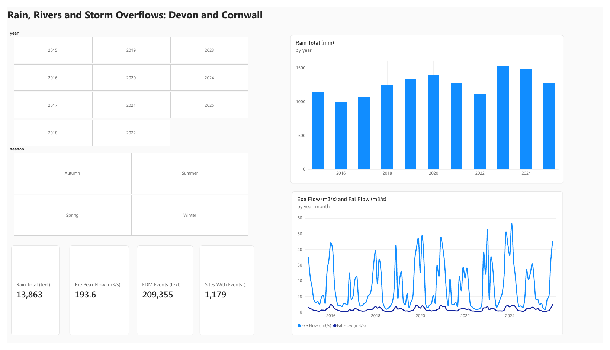
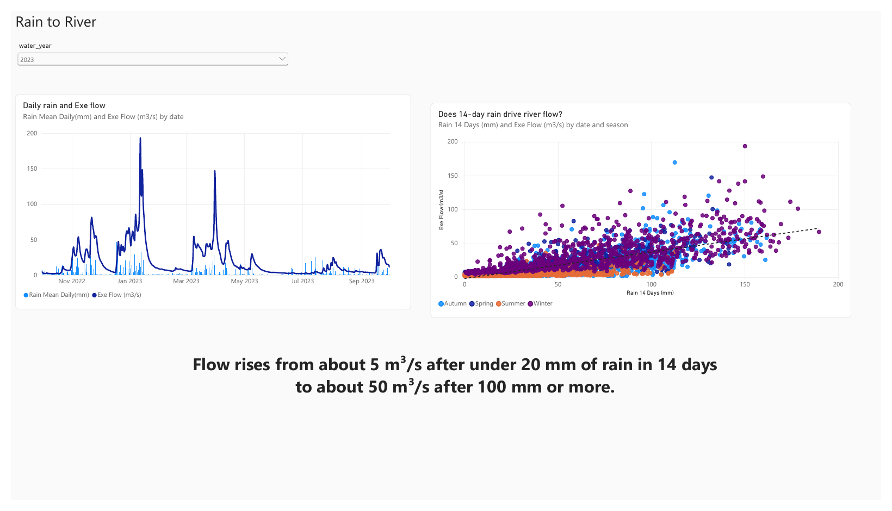
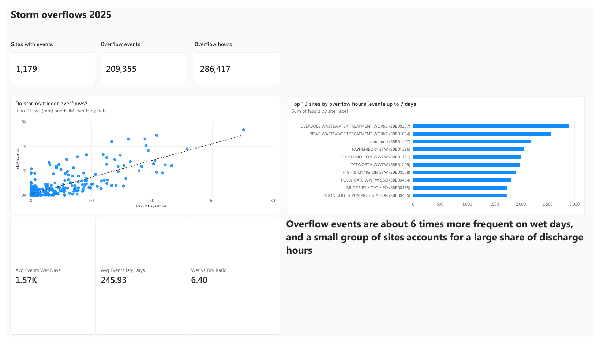

# Rainfall, River Flow and Storm Overflows in Devon & Cornwall

An end-to-end analysis of open water data for the South West of England: how rainfall drives river flow, and how closely storm-overflow discharges follow rainfall. Built with **Python (pandas, scikit-learn)** and **SQL (SQLite)**, with data-quality checks and honest limitations throughout.

## Question
How does rainfall drive river flow in the South West, and how closely do storm-overflow discharges follow rainfall?

## Data (all open, Open Government Licence v3)
| Source | What | Coverage |
|---|---|---|
| [Environment Agency Hydrology API](https://environment.data.gov.uk/hydrology) | Daily rainfall (7 gauges within 60 km of Exeter) and daily mean river flow (River Exe at Thorverton, River Fal at Trenowth) | 2015–2025, ≈36,000 daily readings |
| [Event Duration Monitoring: Storm Overflow Start/Stop Detailed Data](https://www.data.gov.uk/dataset/39ba1e24-69ca-4031-badf-e02649b74a7b/event-duration-monitoring-storm-overflow-start-stop-detailed-data) | South West Water 2025 storm-overflow events | 209,711 events, 1,179 sites |

## Key findings
1. **Rain gauges agree** (correlation 0.86–0.91 with the mean of the others), so a regional mean is a reasonable rainfall index.
2. **The River Exe responds to rain within a day** (peak correlation at a 1-day lag, 0.54). **Antecedent wetness matters more than same-day rain:** the last 14 days of rainfall correlate 0.77 with log-flow, against 0.34 for the same day alone.
3. **A simple next-day flow model beats persistence** on held-out 2023–24 data: NSE 0.85 vs 0.78, RMSE 9.5 vs 11.5 m³/s. It still overshoots some flood peaks (mean +4.5 m³/s on the top 5% of flow days).
4. **Overflow activity follows rainfall.** In 2025, days with ≥10 mm of rain over the previous two days averaged ~1,580 overflow events per day against ~250 on other days (Spearman 0.65).
5. **Rainfall is not the whole story.** December 2025 had roughly 72,000 events against about 39,000 in January with almost the same rainfall, in a year that was not unusually wet.
6. **Low flow clusters in a few years** (SQL): 2022 (133 days below the long-run 10th percentile), 2018 (81) and 2025 (65), against 6–33 in other years.
7. **Overflow impact is concentrated:** the worst 10% of sites account for about 47% of all discharge hours.

## Power BI dashboard
A six-page report built on the exported tables (star schema: `dim_date`, `dim_station`, `fact_daily_readings`, `fact_edm_events`, `fact_edm_daily`) with DAX measures. Download [`powerbi/water_dashboard.pbix`](powerbi/water_dashboard.pbix) (Power BI Desktop) or open the [PDF export](powerbi/water_dashboard.pdf).

| Page | What it shows |
|---|---|
| Overview | Annual rainfall, Exe and Fal flow, headline numbers, year and season filters |
| Rain to River | Daily rain against Exe flow; 14-day rainfall against flow with a trend line |
| Low Flow | Days below the long-run 10th-percentile flow, by year (2022, 2018, 2025 stand out) |
| Storm Overflows 2025 | Overflow events against 2-day rain, wet-day vs dry-day averages (about 6.4 times), top 10 sites by discharge hours |
| Data Quality | Reading quality by station, share not rated Good, excluded long events |
| Method and Limits | Sources, cleaning decisions and limitations |

## Data quality (what I found and how I handled it)
- One flow series had **duplicate daily readings** for a year (two per day); kept the 09:00 reading for consistency with all other stations.
- **10.7% of readings** are Suspect, Estimated or Unchecked: kept but flagged; the rainfall index excludes Suspect readings.
- Missing values are set to NaN, never zero.
- **356 overflow events last more than 7 days** (up to ~97 days), likely monitor faults or unclosed events: flagged and excluded from counts.
- 2,207 overflow events have no site name: kept and reported.

## Limitations
Correlation is not causation. One flow catchment is modelled. The overflow data is self-reported by the water company and not verified by the Environment Agency, covers one year, and **event counts are not discharge volumes**.

## Repository
- `water_rainfall_river_overflow.ipynb`: full analysis (data download, cleaning, QA, modelling, SQL, export)
- `sql/analysis.sql`: the 11 SQL queries used in the notebook
- `images/`: charts used above
- `powerbi/`: Power BI report (`.pbix`), PDF export and page screenshots

## Run it
Click the Colab badge, then **Runtime → Restart session and run all**. Rainfall and flow download automatically from the Hydrology API. If the automatic download of the overflow file fails, download `South West Water 2025 Detailed EDM Data.csv` from the data.gov.uk link above and upload it when the notebook asks.

## Next steps
More catchments and years of overflow data; discharge duration per site as the impact measure; gradient-boosted and probabilistic flow forecasts; linking sites to receiving waters.

*Contains public sector information licensed under the Open Government Licence v3.0.*
